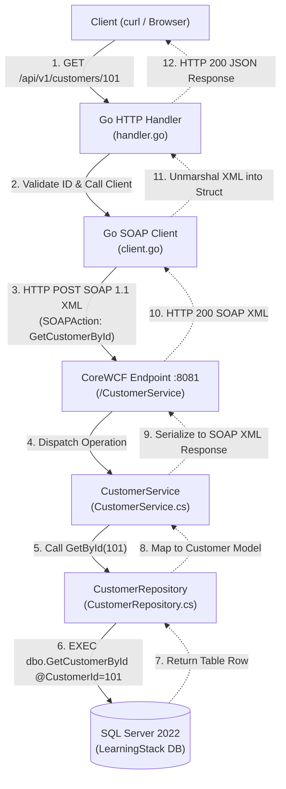
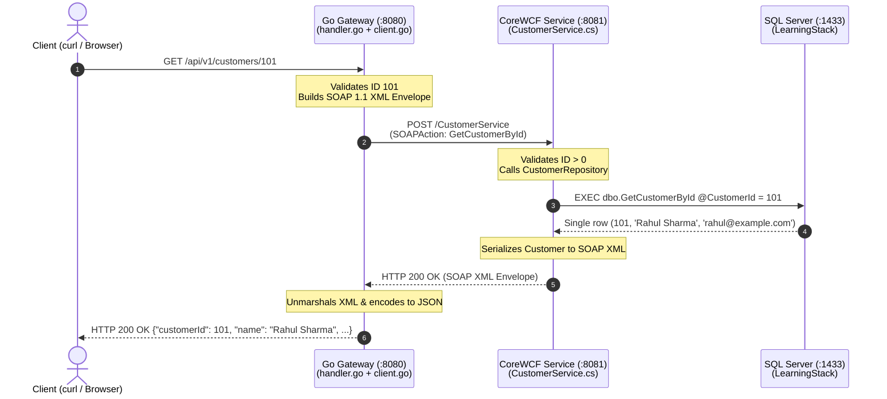

# Trace one request end to end

Request: `GET http://localhost:8080/api/v1/customers/101`

1. `go-gateway/cmd/api/main.go` wires together the Go server, HTTP handler, and SOAP client.
2. `go-gateway/internal/httpapi/handler.go` matches the route, validates the ID, calls `CustomerByID`, and maps the result to JSON/HTTP status.
3. `go-gateway/internal/soapclient/client.go` builds a SOAP 1.1 XML envelope, sets `Content-Type` and `SOAPAction`, sends HTTP POST to WCF, and decodes the SOAP response.
4. `wcf-service/Contracts/ICustomerService.cs` declares the WCF contract and operation.
5. `wcf-service/Services/CustomerService.cs` validates the ID and delegates to `CustomerRepository`.
6. `wcf-service/Data/CustomerRepository.cs` opens a SQL Server connection, executes `dbo.GetCustomerById` with a typed parameter, and maps the row into `Customer`.
7. CoreWCF serializes the result into SOAP/XML. Go parses it and returns JSON.

### Visual Request Map

## Debug in order

1. `curl http://localhost:8081/healthz` — is the WCF host process up?
2. `curl 'http://localhost:8081/CustomerService?wsdl'` — is SOAP metadata reachable?
3. Check `docker logs learningstack-sql` and verify the database setup script completed.
4. Confirm the WCF terminal has `ConnectionStrings__AppDb` set correctly.
5. Confirm Go has `WCF_SOAP_URL=http://localhost:8081/CustomerService`.
6. Compare the request's SOAP action, operation name, namespace, and parameter name with `ICustomerService.cs`.
7. If direct WCF works but Go fails, inspect the Go terminal and SOAP response body.

## Suggested exercise

Change the ID to 102, add a second seed customer in `database/setup.sql`, rerun the SQL script, and trace the request again. Then try a nonexistent ID to observe the `404` mapping.
